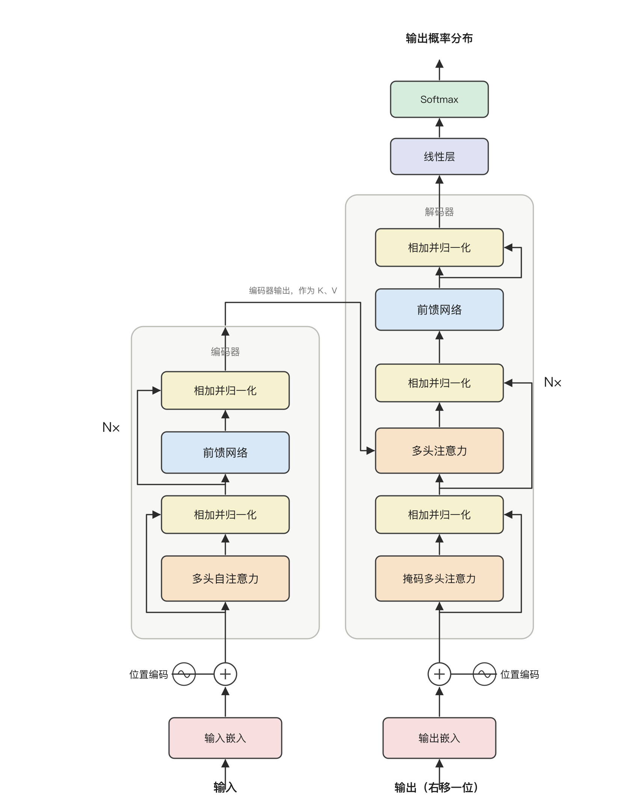
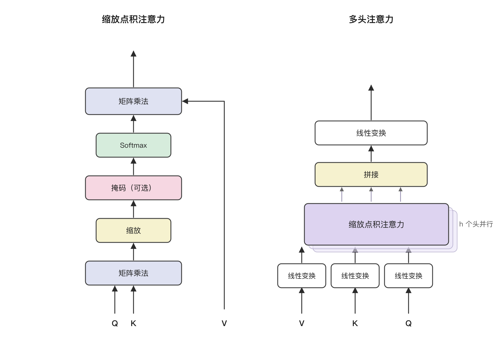
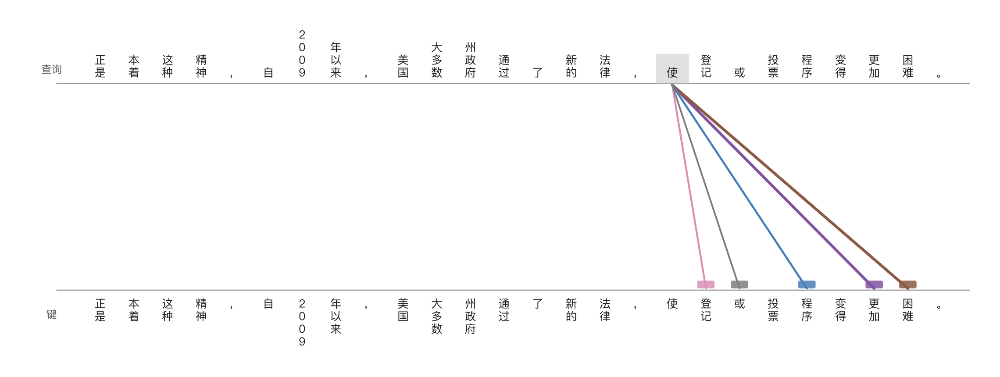
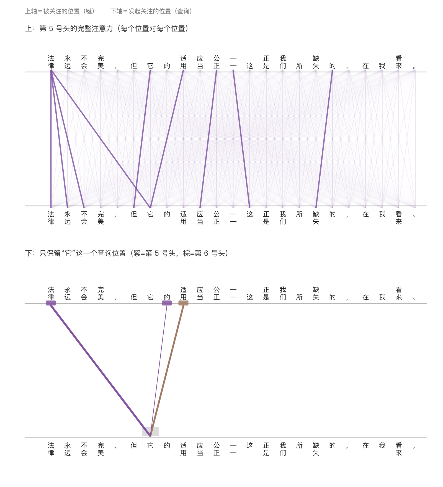
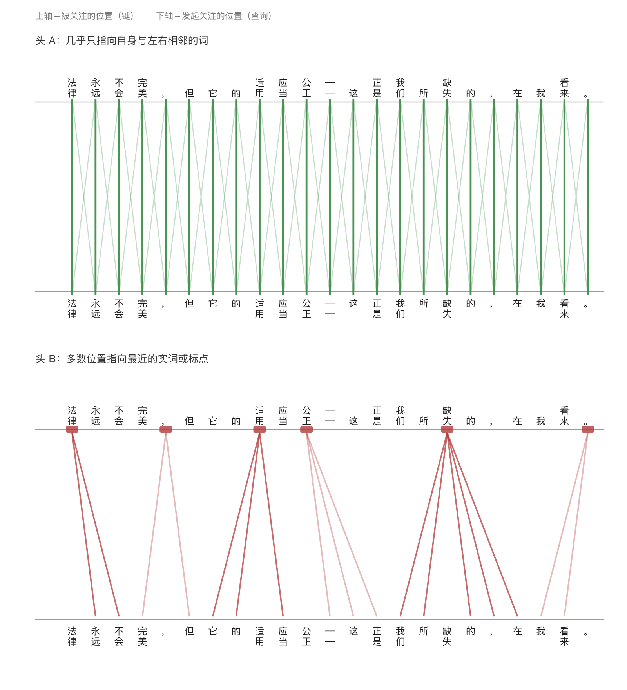

# 注意力就是你所需要的一切

**Attention Is All You Need**

Ashish Vaswani\*（Google Brain，avaswani@google.com）
Noam Shazeer\*（Google Brain，noam@google.com）
Niki Parmar\*（Google Research，nikip@google.com）
Jakob Uszkoreit\*（Google Research，usz@google.com）
Llion Jones\*（Google Research，llion@google.com）
Aidan N. Gomez\*†（多伦多大学，aidan@cs.toronto.edu）
Łukasz Kaiser\*（Google Brain，lukaszkaiser@google.com）
Illia Polosukhin\*‡（illia.polosukhin@gmail.com）

\* 同等贡献。作者排序为随机顺序。Jakob 提出用自注意力取代 RNN，并启动了评估这一想法的工作。Ashish 与 Illia 设计并实现了最初的 Transformer 模型，并在本工作的每一个环节中发挥了关键作用。Noam 提出了缩放点积注意力、多头注意力以及无参数的位置表示，并成为几乎参与每一个细节的另一位成员。Niki 在我们最初的代码库和 tensor2tensor 中设计、实现、调优并评估了无数模型变体。Llion 也试验了新的模型变体，负责我们最初的代码库，以及高效的推断与可视化。Lukasz 与 Aidan 度过了无数漫长的日子，设计 tensor2tensor 的各个部分并加以实现，用它替换了我们早先的代码库，大幅提升了结果并极大加速了我们的研究。† 本工作完成于在 Google Brain 任职期间。‡ 本工作完成于在 Google Research 任职期间。

第 31 届神经信息处理系统大会（NIPS 2017），美国加州长滩。

> **译者说明**
> 1. 原文为 arXiv:1706.03762v7（NIPS 2017 正式版）。译文严格对应原文段落顺序与句意，不增删论证、数据与限定语；原文的脚注以脚注形式保留在原位置。
> 2. 术语采用国内学界通行译法，关键术语在首次出现时以括号给出英文原词，便于对照。$d_{\text{model}}$、$d_k$、$d_v$、$d_{ff}$ 等符号保持原样，不作翻译。
> 3. 五张插图均按原图结构**重新绘制为中文版**：方框、箭头、连线关系与原图一一对应，图内全部英文标注已换为中文，不需要对照英文即可阅读。图 3—图 5 的坐标轴为示例句子的分词序列（已译为中文），其线条深浅按原图目测近似，用于说明模式，不精确对应权重数值。

---

## 摘要

主流的序列转导（sequence transduction）模型基于复杂的循环或卷积神经网络，其中包含一个编码器和一个解码器。性能最好的模型还通过注意力机制把编码器与解码器连接起来。我们提出一种新的简单网络架构——Transformer，它完全基于注意力机制，彻底摒弃了循环与卷积。在两个机器翻译任务上的实验表明，这些模型在质量上更优，同时更易于并行化，训练所需时间也显著更少。我们的模型在 WMT 2014 英德翻译任务上取得 28.4 的 BLEU，比现有最佳结果（包括集成模型）高出 2 BLEU 以上。在 WMT 2014 英法翻译任务上，我们的模型在 8 块 GPU 上训练 3.5 天后，建立了 41.8 的单模型最优 BLEU 分数，其训练成本仅为文献中最佳模型的一小部分。我们将 Transformer 成功应用于英语成分句法分析（无论训练数据充足还是有限），表明它能很好地泛化到其他任务。

---

## 1 引言

循环神经网络，尤其是长短期记忆网络 [13] 和门控循环 [7] 神经网络，已被牢固地确立为序列建模与转导问题（如语言建模和机器翻译 [35, 2, 5]）的最先进方法。此后，大量工作持续拓展循环语言模型与编码器—解码器架构的边界 [38, 24, 15]。

循环模型通常沿输入与输出序列的符号位置来分解计算。它们把位置对齐到计算时间步，生成隐藏状态序列 $h_t$，该状态是前一隐藏状态 $h_{t-1}$ 与位置 $t$ 处输入的函数。这种固有的顺序性排除了训练样本内部的并行化，而当序列较长时这一点变得至关重要，因为内存约束限制了跨样本的批处理。近期的工作通过因子分解技巧 [21] 和条件计算 [32] 在计算效率上取得了显著改进，后者同时还改善了模型性能。然而，顺序计算这一根本性约束依然存在。

注意力机制已成为各类任务中颇具竞争力的序列建模与转导模型不可或缺的组成部分，它使得在不考虑依赖关系在输入或输出序列中距离的情况下对其建模成为可能 [2, 19]。然而，除少数情况外 [27]，这类注意力机制都是与循环网络结合使用的。

在本工作中，我们提出 Transformer，这是一种摒弃循环、转而完全依赖注意力机制来刻画输入与输出之间全局依赖的模型架构。Transformer 允许显著更多的并行化，在 8 块 P100 GPU 上仅训练 12 小时，即可达到翻译质量的新最优水平。

## 2 背景

减少顺序计算这一目标，同样构成了 Extended Neural GPU [16]、ByteNet [18] 和 ConvS2S [9] 的基础，它们都以卷积神经网络作为基本构件，为所有输入和输出位置并行地计算隐藏表示。在这些模型中，关联任意两个输入或输出位置上的信号所需的操作数随位置间距离增长：对 ConvS2S 是线性增长，对 ByteNet 是对数增长。这使学习远距离位置之间的依赖关系变得更加困难 [12]。在 Transformer 中，这一操作数被降为常数，代价是由于对注意力加权的位置取平均而降低了有效分辨率；我们通过第 3.2 节所述的多头注意力来抵消这一效应。

自注意力（self-attention），有时也称为内部注意力（intra-attention），是一种把单个序列的不同位置相互关联、以计算该序列表示的注意力机制。自注意力已被成功用于多种任务，包括阅读理解、生成式摘要、文本蕴涵，以及学习与任务无关的句子表示 [4, 27, 28, 22]。端到端记忆网络基于循环注意力机制，而非与序列对齐的循环，已被证明在简单语言问答和语言建模任务上表现良好 [34]。

然而，据我们所知，Transformer 是第一个完全依靠自注意力来计算其输入与输出表示、而不使用与序列对齐的 RNN 或卷积的转导模型。在接下来的章节中，我们将描述 Transformer，说明采用自注意力的动机，并讨论它相对于 [17, 18] 和 [9] 等模型的优势。

## 3 模型架构

大多数有竞争力的神经序列转导模型都具有编码器—解码器结构 [5, 2, 35]。这里，编码器把由符号表示构成的输入序列 $(x_1, \dots, x_n)$ 映射为连续表示序列 $z = (z_1, \dots, z_n)$。给定 $z$ 之后，解码器逐个元素地生成由符号构成的输出序列 $(y_1, \dots, y_m)$。每一步中模型都是自回归的（auto-regressive）[10]，即在生成下一个符号时，把先前已生成的符号作为额外输入消费掉。

**图 1：Transformer——模型架构。**

> **读图要点。** 数据自下而上流动。词元先经嵌入层变成向量，再与位置编码逐元素相加，随后进入 6 层堆叠。左半是编码器，每层只做两件事——多头自注意力（让每个位置看到全句）与逐位置前馈网络，两者各自带一条绕行的残差连线并做归一化。右半是解码器，比编码器多一个子层：它拿解码器当前的表示当查询，去查编码器输出的键与值（图中标注"编码器输出，作为 K、V"的那条线）。解码器最下面的自注意力带掩码，只能看到当前位置及之前的词，这是"输出（右移一位）"能与训练并行、又不泄题的原因。最上端的线性层与 Softmax 把最后一层向量变成下一个词的概率分布。

Transformer 遵循这一总体架构，编码器和解码器均使用堆叠的自注意力层与逐位置全连接层，分别如图 1 的左半部分与右半部分所示。

### 3.1 编码器与解码器堆叠

**编码器：** 编码器由 $N = 6$ 个相同层堆叠而成。每一层有两个子层。第一个是多头自注意力机制，第二个是简单的、逐位置的全连接前馈网络。我们在两个子层周围各采用一条残差连接 [11]，随后进行层归一化（layer normalization）[1]。也就是说，每个子层的输出为 $\mathrm{LayerNorm}(x + \mathrm{Sublayer}(x))$，其中 $\mathrm{Sublayer}(x)$ 是该子层自身实现的函数。为便于这些残差连接，模型中所有子层以及嵌入层都产生维度为 $d_{\text{model}} = 512$ 的输出。

**解码器：** 解码器同样由 $N = 6$ 个相同层堆叠而成。除了每个编码器层中的两个子层之外，解码器还插入第三个子层，它对编码器堆叠的输出执行多头注意力。与编码器类似，我们在每个子层周围采用残差连接，随后进行层归一化。我们还修改了解码器堆叠中的自注意力子层，以防止某个位置关注到其后的位置。这种掩码，再加上输出嵌入被偏移一个位置这一事实，共同保证了对位置 $i$ 的预测只能依赖于位置小于 $i$ 的已知输出。

### 3.2 注意力

注意力函数可以描述为把一个查询（query）和一组键—值对（key-value pair）映射为一个输出，其中查询、键、值以及输出都是向量。输出是各个值的加权和，其中赋予每个值的权重由查询与相应键的兼容性函数（compatibility function）计算得到。

**图 2：（左）缩放点积注意力。（右）多头注意力由若干个并行运行的注意力层构成。**

> **读图要点。** 左图是一条算式被拆成的流水线——查询 Q 与键 K 先做矩阵乘法得到打分，除以 √d_k 缩放，可选地施加掩码，Softmax 归一化成权重，最后与值 V 再做一次矩阵乘法。注意 V 那条线绕过了整条打分链路，直接进入最后一次乘法：它提供的始终是"内容"，而不是"匹配分"。右图把这条流水线复制 h 份并行：V、K、Q 各先经过一次独立的线性变换，分别进入 h 个缩放点积注意力，结果拼接后再做一次线性变换输出。层叠的方框表示这 h 份是并行的、结构完全相同的副本。

#### 3.2.1 缩放点积注意力

我们把自己所用的这种特定注意力称为"缩放点积注意力"（图 2）。其输入由维度为 $d_k$ 的查询与键、以及维度为 $d_v$ 的值组成。我们计算查询与所有键的点积，把每个点积除以 $\sqrt{d_k}$，再施加 softmax 函数，得到作用于各个值上的权重。在实践中，我们同时对一组查询计算注意力函数，把它们打包进矩阵 $Q$。键和值同样被打包进矩阵 $K$ 和 $V$。我们按下式计算输出矩阵：

$$
\mathrm{Attention}(Q, K, V) = \mathrm{softmax}\left(\frac{QK^\top}{\sqrt{d_k}}\right)V \tag{1}
$$

两种最常用的注意力函数是加性注意力（additive attention）[2] 和点积（乘性）注意力。除缩放因子 $\frac{1}{\sqrt{d_k}}$ 之外，点积注意力与我们的算法完全相同。加性注意力使用一个带单隐藏层的前馈网络来计算兼容性函数。虽然两者在理论复杂度上相近，但点积注意力在实践中要快得多、也更节省空间，因为它可以用高度优化的矩阵乘法代码来实现。当 $d_k$ 取值较小时，两种机制的表现相似；而当 $d_k$ 取值较大时，不加缩放的加性注意力优于点积注意力 [3]。我们推测，对于较大的 $d_k$，点积的数值会变得很大，从而把 softmax 函数推入其梯度极小的区域4。为抵消这一效应，我们把点积按 $\frac{1}{\sqrt{d_k}}$ 缩放。

> 4 为说明点积为何会变大，假设 $q$ 和 $k$ 的各分量是均值为 0、方差为 1 的独立随机变量。那么它们的点积 $q \cdot k = \sum_{i=1}^{d_k} q_i k_i$ 的均值为 0，方差为 $d_k$。

#### 3.2.2 多头注意力

我们没有用 $d_{\text{model}}$ 维的键、值和查询去执行单一的注意力函数，而是发现：用 $h$ 个不同的、可学习的线性投影，分别把查询、键和值映射到 $d_k$、$d_k$ 和 $d_v$ 维，是有益的。随后，在这些投影后的查询、键和值版本上，我们并行地执行注意力函数，得到 $d_v$ 维的输出值。这些输出被拼接起来并再次投影，得到最终的值，如图 2 所示。

多头注意力使模型能够同时关注不同位置上不同表示子空间的信息。若只有单个注意力头，这种能力会被平均化所抑制。

$$
\mathrm{MultiHead}(Q, K, V) = \mathrm{Concat}(\mathrm{head}_1, \dots, \mathrm{head}_h)W^O
$$

$$
\text{其中 } \mathrm{head}_i = \mathrm{Attention}\left(QW_i^Q,\ KW_i^K,\ VW_i^V\right)
$$

其中各投影为参数矩阵 $W_i^Q \in \mathbb{R}^{d_{\text{model}} \times d_k}$、$W_i^K \in \mathbb{R}^{d_{\text{model}} \times d_k}$、$W_i^V \in \mathbb{R}^{d_{\text{model}} \times d_v}$，以及 $W^O \in \mathbb{R}^{h d_v \times d_{\text{model}}}$。在本工作中我们采用 $h = 8$ 个并行注意力层，即 8 个头。对每个头，我们取 $d_k = d_v = d_{\text{model}}/h = 64$。由于每个头的维度降低，总计算成本与全维度的单头注意力相当。

#### 3.2.3 注意力在本模型中的应用

Transformer 以三种不同的方式使用多头注意力：

- 在"编码器—解码器注意力"层中，查询来自前一个解码器层，而记忆的键与值来自编码器的输出。这使解码器中的每个位置都能关注输入序列中的所有位置。这模仿了序列到序列模型中典型的编码器—解码器注意力机制，例如 [38, 2, 9] 中的做法。

- 编码器包含自注意力层。在自注意力层中，所有的键、值和查询都来自同一处，在这里即编码器中前一层的输出。编码器中的每个位置都能关注编码器前一层的所有位置。

- 类似地，解码器中的自注意力层允许解码器中的每个位置关注解码器中截至该位置（含该位置）的所有位置。我们需要阻止解码器中的信息向左流动，以保持自回归性质。我们在缩放点积注意力内部实现这一点：把 softmax 输入中所有对应非法连接的值屏蔽掉（置为 $-\infty$）。参见图 2。

### 3.3 逐位置前馈网络

除注意力子层之外，我们编码器和解码器中的每一层都包含一个全连接前馈网络，它被独立且以相同方式应用于每个位置。该网络由两个线性变换构成，两者之间夹一个 ReLU 激活。

$$
\mathrm{FFN}(x) = \max(0, xW_1 + b_1)W_2 + b_2 \tag{2}
$$

虽然这些线性变换在不同位置之间是相同的，但它们在层与层之间使用不同的参数。另一种描述方式是：把它看作两个核大小为 1 的卷积。输入与输出的维度为 $d_{\text{model}} = 512$，内层的维度为 $d_{ff} = 2048$。

### 3.4 嵌入与 Softmax

与其他序列转导模型类似，我们使用可学习的嵌入把输入词元和输出词元转换为 $d_{\text{model}}$ 维的向量。我们还使用通常的可学习线性变换和 softmax 函数，把解码器输出转换为对下一个词元的预测概率。在我们的模型中，两个嵌入层与 softmax 之前的线性变换共享同一个权重矩阵，这与 [30] 类似。在嵌入层中，我们把这些权重乘以 $\sqrt{d_{\text{model}}}$。

**表 1：不同层类型的最大路径长度、每层复杂度与最少顺序操作数。$n$ 为序列长度，$d$ 为表示维度，$k$ 为卷积核大小，$r$ 为受限自注意力中邻域的大小。**

| 层类型 | 每层复杂度 | 顺序操作数 | 最大路径长度 |
| --- | --- | --- | --- |
| 自注意力 | $O(n^2 \cdot d)$ | $O(1)$ | $O(1)$ |
| 循环层 | $O(n \cdot d^2)$ | $O(n)$ | $O(n)$ |
| 卷积层 | $O(k \cdot n \cdot d^2)$ | $O(1)$ | $O(\log_k(n))$ |
| 自注意力（受限） | $O(r \cdot n \cdot d)$ | $O(1)$ | $O(n/r)$ |

### 3.5 位置编码

由于我们的模型既不含循环也不含卷积，为了让模型能够利用序列的顺序，我们必须注入一些关于词元在序列中相对或绝对位置的信息。为此，我们在编码器和解码器堆叠的底部，把"位置编码"加到输入嵌入上。位置编码与嵌入具有相同的维度 $d_{\text{model}}$，因此二者可以直接相加。位置编码有多种选择，既有可学习的，也有固定的 [9]。

在本工作中，我们使用不同频率的正弦和余弦函数：

$$
PE_{(pos, 2i)} = \sin\left(pos/10000^{2i/d_{\text{model}}}\right)
$$

$$
PE_{(pos, 2i+1)} = \cos\left(pos/10000^{2i/d_{\text{model}}}\right)
$$

其中 $pos$ 是位置，$i$ 是维度。也就是说，位置编码的每个维度都对应一条正弦曲线。其波长构成一个从 $2\pi$ 到 $10000 \cdot 2\pi$ 的几何级数。我们选择这一函数，是因为我们假设它能让模型容易地学会按相对位置进行关注：因为对任意固定的偏移 $k$，$PE_{pos+k}$ 都可以表示为 $PE_{pos}$ 的线性函数。

我们也试验了改用可学习的位置嵌入 [9]，发现两种版本产生的结果几乎相同（见表 3 第 (E) 行）。我们选择正弦版本，是因为它或许能让模型外推到比训练中所遇到的更长的序列长度。

## 4 为什么用自注意力

在本节中，我们把自注意力层的各个方面，与常用于将一个变长的符号表示序列 $(x_1, \dots, x_n)$ 映射为另一个等长序列 $(z_1, \dots, z_n)$（其中 $x_i, z_i \in \mathbb{R}^d$）的循环层和卷积层进行比较，例如典型序列转导编码器或解码器中的隐藏层。为说明我们采用自注意力的动机，我们考虑三项期望属性。一是每层的总计算复杂度。二是可以并行化的计算量，以所需的最少顺序操作数来衡量。

三是在网络中长程依赖之间的路径长度。学习长程依赖是许多序列转导任务的关键挑战。影响学习此类依赖能力的一个关键因素，是前向与反向信号在网络中必须经过的路径长度。输入与输出序列中任意位置组合之间的这些路径越短，就越容易学习长程依赖 [12]。因此我们还比较了由不同层类型构成的网络中，任意两个输入与输出位置之间的最大路径长度。

如表 1 所示，自注意力层用常数个顺序执行的操作连接所有位置，而循环层需要 $O(n)$ 个顺序操作。就计算复杂度而言，当序列长度 $n$ 小于表示维度 $d$ 时，自注意力层比循环层更快——而这在机器翻译中当前最优模型所用的句子表示（如 word-piece [38] 和字节对 [31] 表示）里通常是成立的。为提升涉及超长序列任务的计算性能，可以把自注意力限制为只考虑输入序列中、以相应输出位置为中心、大小为 $r$ 的邻域。这会把最大路径长度增加到 $O(n/r)$。我们计划在未来的工作中进一步研究这一思路。

核宽度为 $k < n$ 的单个卷积层并不能连接所有输入与输出位置对。要做到这一点，在连续核的情况下需要堆叠 $O(n/k)$ 个卷积层，在膨胀卷积（dilated convolution）[18] 的情况下需要 $O(\log_k(n))$ 个，从而增加了网络中任意两个位置之间最长路径的长度。卷积层通常比循环层更昂贵，代价因子为 $k$。然而，可分离卷积（separable convolution）[6] 可将复杂度显著降低到 $O(k \cdot n \cdot d + n \cdot d^2)$。但即便取 $k = n$，可分离卷积的复杂度也等同于一个自注意力层与一个逐位置前馈层的组合，而这正是我们模型所采用的做法。

作为附带的好处，自注意力可能产生更具可解释性的模型。我们检查了模型中的注意力分布，并在附录中给出并讨论了示例。不仅各个注意力头明显学会了执行不同的任务，许多头还表现出与句子的句法和语义结构相关的行为。

## 5 训练

本节描述我们模型的训练方案。

### 5.1 训练数据与批处理

我们在标准的 WMT 2014 英德数据集上训练，该数据集由约 450 万个句子对构成。句子使用字节对编码（byte-pair encoding）[3] 进行编码，其源语言与目标语言共享约 37000 个词元的词表。对于英法，我们使用了规模大得多的 WMT 2014 英法数据集，它由 3600 万个句子构成，并把词元切分为 32000 个 word-piece 的词表 [38]。句子对按近似序列长度批在一起。每个训练批次包含一组句子对，其中约含 25000 个源语言词元和 25000 个目标语言词元。

### 5.2 硬件与时间安排

我们在一台配备 8 块 NVIDIA P100 GPU 的机器上训练模型。对于使用全文所述超参数的 base 模型，每个训练步耗时约 0.4 秒。我们训练 base 模型共 100,000 步，即 12 小时。对于 big 模型（列于表 3 的最后一行），每步耗时为 1.0 秒。big 模型训练了 300,000 步（3.5 天）。

### 5.3 优化器

我们使用 Adam 优化器 [20]，其中 $\beta_1 = 0.9$、$\beta_2 = 0.98$、$\epsilon = 10^{-9}$。我们在训练过程中按以下公式改变学习率：

$$
\mathrm{lrate} = d_{\text{model}}^{-0.5} \cdot \min\left(\mathrm{step\_num}^{-0.5},\ \mathrm{step\_num} \cdot \mathrm{warmup\_steps}^{-1.5}\right) \tag{3}
$$

这相当于在最初的 $\mathrm{warmup\_steps}$ 个训练步内线性地增加学习率，此后再按步数的平方根倒数成比例地递减。我们取 $\mathrm{warmup\_steps} = 4000$。

### 5.4 正则化

训练期间我们采用三种类型的正则化：

**残差 Dropout** 我们对每个子层的输出施加 dropout [33]，施加位置是在它被加到子层输入并归一化之前。此外，我们对编码器和解码器两个堆叠中嵌入与位置编码之和也施加 dropout。对 base 模型，我们使用 $P_{drop} = 0.1$ 的比率。

**标签平滑** 训练期间我们采用了值为 $\epsilon_{ls} = 0.1$ 的标签平滑 [36]。这会损害困惑度（perplexity），因为模型学会了更加"不确定"，但它提升了准确率和 BLEU 分数。

## 6 结果

### 6.1 机器翻译

在 WMT 2014 英德翻译任务上，big transformer 模型（表 2 中的 Transformer (big)）比此前报告的最佳模型（包括集成模型）高出 2.0 BLEU 以上，创造了 28.4 的新最优 BLEU 分数。该模型的配置列于表 3 的最后一行。训练在 8 块 P100 GPU 上耗时 3.5 天。即便是我们的 base 模型，也超过了所有此前已发表的模型与集成模型，而训练成本只是任何竞争模型的一小部分。在 WMT 2014 英法翻译任务上，我们的 big 模型取得了 41.0 的 BLEU 分数，超过了此前发表的所有单模型，训练成本不到此前最优模型的 1/4。用于英法翻译的 Transformer (big) 模型使用 dropout 率 $P_{drop} = 0.1$，而非 0.3。

对于 base 模型，我们使用对最后 5 个检查点取平均所得到的单一模型，这些检查点每隔 10 分钟写入一次。对于 big 模型，我们对最后 20 个检查点取平均。我们使用束大小（beam size）为 4、长度惩罚 $\alpha = 0.6$ 的束搜索（beam search）[38]。这些超参数是在开发集上经过实验后选定的。我们把推断时的最大输出长度设为输入长度 + 50，但在可能时提前终止 [38]。

表 2 总结了我们的结果，并把翻译质量与训练成本同文献中的其他模型架构进行了比较。我们通过将训练时间、所用 GPU 数量以及每块 GPU 持续单精度浮点运算能力的估计值三者相乘，来估算训练一个模型所用的浮点运算次数5。

> 5 我们对 K80、K40、M40 和 P100 分别采用 2.8、3.7、6.0 和 9.5 TFLOPS 的数值。

**表 2：在英德与英法 newstest2014 测试集上，Transformer 以一小部分训练成本取得了比此前最优模型更好的 BLEU 分数。**

| 模型 | BLEU（英德） | BLEU（英法） | 训练成本 FLOPs（英德） | 训练成本 FLOPs（英法） |
| --- | --- | --- | --- | --- |
| ByteNet [18] | 23.75 | — | — | — |
| Deep-Att + PosUnk [39] | — | 39.2 | — | $1.0 \cdot 10^{20}$ |
| GNMT + RL [38] | 24.6 | 39.92 | $2.3 \cdot 10^{19}$ | $1.4 \cdot 10^{20}$ |
| ConvS2S [9] | 25.16 | 40.46 | $9.6 \cdot 10^{18}$ | $1.5 \cdot 10^{20}$ |
| MoE [32] | 26.03 | 40.56 | $2.0 \cdot 10^{19}$ | $1.2 \cdot 10^{20}$ |
| Deep-Att + PosUnk 集成 [39] | — | 40.4 | — | $8.0 \cdot 10^{20}$ |
| GNMT + RL 集成 [38] | 26.30 | 41.16 | $1.8 \cdot 10^{20}$ | $1.1 \cdot 10^{21}$ |
| ConvS2S 集成 [9] | 26.36 | 41.29 | $7.7 \cdot 10^{19}$ | $1.2 \cdot 10^{21}$ |
| Transformer（base 模型） | 27.3 | 38.1 | $\mathbf{3.3 \cdot 10^{18}}$ | — |
| Transformer（big 模型） | **28.4** | **41.8** | $2.3 \cdot 10^{19}$ | — |

### 6.2 模型变体

为评估 Transformer 各组成部分的重要性，我们以不同方式改变 base 模型，测量其在英德翻译开发集 newstest2013 上的性能变化。我们使用上一节所述的束搜索，但不做检查点平均。结果列于表 3。在表 3 的 (A) 组中，我们按第 3.2.2 节所述，在保持计算量不变的前提下改变注意力头的数量以及注意力的键、值维度。单头注意力比最佳设置差 0.9 BLEU，但头数过多时质量同样会下降。在表 3 的 (B) 组中，我们观察到减小注意力键的维度 $d_k$ 会损害模型质量。这表明确定兼容性并不容易，采用比点积更精巧的兼容性函数可能会带来收益。我们进一步在 (C) 和 (D) 组中观察到，正如预期，更大的模型更好，而 dropout 对避免过拟合非常有帮助。在 (E) 组中，我们用可学习的位置嵌入 [9] 替换了正弦位置编码，观察到的结果与 base 模型几乎相同。

**表 3：Transformer 架构的变体。未列出的取值与 base 模型相同。所有指标均在英德翻译开发集 newstest2013 上测得。表中困惑度按我们的字节对编码以词片（wordpiece）为单位计算，不应与按词计算的困惑度相比较。**

| 组 | $N$ | $d_{\text{model}}$ | $d_{ff}$ | $h$ | $d_k$ | $d_v$ | $P_{drop}$ | $\epsilon_{ls}$ | 训练步数 | PPL（开发集） | BLEU（开发集） | 参数量 $\times 10^6$ |
| --- | --- | --- | --- | --- | --- | --- | --- | --- | --- | --- | --- | --- |
| base | 6 | 512 | 2048 | 8 | 64 | 64 | 0.1 | 0.1 | 100K | 4.92 | 25.8 | 65 |
| (A) | | | | 1 | 512 | 512 | | | | 5.29 | 24.9 | |
| | | | | 4 | 128 | 128 | | | | 5.00 | 25.5 | |
| | | | | 16 | 32 | 32 | | | | 4.91 | 25.8 | |
| | | | | 32 | 16 | 16 | | | | 5.01 | 25.4 | |
| (B) | | | | 16 | | | | | | 5.16 | 25.1 | 58 |
| | | | | 32 | | | | | | 5.01 | 25.4 | 60 |
| (C) | 2 | | | | | | | | | 6.11 | 23.7 | 36 |
| | 4 | | | | | | | | | 5.19 | 25.3 | 50 |
| | 8 | | | | | | | | | 4.88 | 25.5 | 80 |
| | | 256 | | | 32 | 32 | | | | 5.75 | 24.5 | 28 |
| | | 1024 | | | 128 | 128 | | | | 4.66 | 26.0 | 168 |
| | | | 1024 | | | | | | | 5.12 | 25.4 | 53 |
| | | | 4096 | | | | | | | 4.75 | 26.2 | 90 |
| (D) | | | | | | | 0.0 | | | 5.77 | 24.6 | |
| | | | | | | | 0.2 | | | 4.95 | 25.5 | |
| | | | | | | | | 0.0 | | 4.67 | 25.3 | |
| | | | | | | | | 0.2 | | 5.47 | 25.7 | |
| (E) | 位置嵌入替代正弦编码 | | | | | | | | | 4.92 | 25.7 | |
| big | 6 | 1024 | 4096 | 16 | | | 0.3 | | 300K | **4.33** | **26.4** | 213 |

### 6.3 英语成分句法分析

为评估 Transformer 能否泛化到其他任务，我们在英语成分句法分析（constituency parsing）上进行了实验。该任务带来特定的挑战：输出受到很强的结构约束，而且明显长于输入。此外，RNN 序列到序列模型在小数据情形下未能取得最优结果 [37]。我们在 Penn Treebank [25] 的《华尔街日报》（WSJ）部分上训练了一个 4 层、$d_{\text{model}} = 1024$ 的 transformer，约含 4 万句训练数据。我们还在半监督设置下训练它，使用规模更大的 high-confidence 与 BerkeleyParser 语料，约 1700 万句 [37]。仅用 WSJ 的设置使用 16K 词元的词表，半监督设置使用 32K 词元的词表。

我们只做了少量实验，以便在第 22 节开发集上选择 dropout（注意力与残差两类，见第 5.4 节）、学习率与束大小，其他所有参数与英德 base 翻译模型保持一致。在推断时，我们把最大输出长度增加到输入长度 + 300。仅 WSJ 与半监督两种设置都使用束大小 21 和 $\alpha = 0.3$。

表 4 中的结果表明，尽管没有针对任务做专门调优，我们的模型表现得出奇地好，优于此前报告的所有模型，唯一例外是循环神经网络语法（Recurrent Neural Network Grammar）[8]。与 RNN 序列到序列模型 [37] 相比，即使只在 4 万句的 WSJ 训练集上训练，Transformer 也优于 Berkeley Parser [29]。

**表 4：Transformer 能很好地泛化到英语成分句法分析（结果在 WSJ 第 23 节上测得）。**

| 句法分析器 | 训练方式 | WSJ 23 F1 |
| --- | --- | --- |
| Vinyals & Kaiser 等（2014）[37] | 仅 WSJ，判别式 | 88.3 |
| Petrov 等（2006）[29] | 仅 WSJ，判别式 | 90.4 |
| Zhu 等（2013）[40] | 仅 WSJ，判别式 | 90.4 |
| Dyer 等（2016）[8] | 仅 WSJ，判别式 | 91.7 |
| Transformer（4 层） | 仅 WSJ，判别式 | 91.3 |
| Zhu 等（2013）[40] | 半监督 | 91.3 |
| Huang & Harper（2009）[14] | 半监督 | 91.3 |
| McClosky 等（2006）[26] | 半监督 | 92.1 |
| Vinyals & Kaiser 等（2014）[37] | 半监督 | 92.1 |
| Transformer（4 层） | 半监督 | 92.7 |
| Luong 等（2015）[23] | 多任务 | 93.0 |
| Dyer 等（2016）[8] | 生成式 | 93.3 |

## 7 结论

在本工作中，我们提出了 Transformer，这是第一个完全基于注意力的序列转导模型，它用多头自注意力取代了编码器—解码器架构中最常使用的循环层。对于翻译任务，Transformer 的训练速度可以显著快于基于循环层或卷积层的架构。在 WMT 2014 英德与 WMT 2014 英法两个翻译任务上，我们都达到了新的最优水平。在前一个任务中，我们最好的模型甚至超过了此前报告的所有集成模型。我们对基于注意力的模型的未来感到兴奋，并计划把它们应用于其他任务。我们计划把 Transformer 扩展到输入与输出模态不限于文本的问题，并研究局部、受限的注意力机制，以高效处理图像、音频和视频这类大规模输入与输出。让生成过程变得不那么顺序化，是我们的另一个研究目标。我们用于训练和评估模型的代码可在 https://github.com/tensorflow/tensor2tensor 获取。

**致谢** 我们感谢 Nal Kalchbrenner 与 Stephan Gouws 提出的富有成效的评论、修正与启发。

## 参考文献

1. Jimmy Lei Ba, Jamie Ryan Kiros, and Geoffrey E Hinton. Layer normalization. arXiv preprint arXiv:1607.06450, 2016.
2. Dzmitry Bahdanau, Kyunghyun Cho, and Yoshua Bengio. Neural machine translation by jointly learning to align and translate. CoRR, abs/1409.0473, 2014.
3. Denny Britz, Anna Goldie, Minh-Thang Luong, and Quoc V. Le. Massive exploration of neural machine translation architectures. CoRR, abs/1703.03906, 2017.
4. Jianpeng Cheng, Li Dong, and Mirella Lapata. Long short-term memory-networks for machine reading. arXiv preprint arXiv:1601.06733, 2016.
5. Kyunghyun Cho, Bart van Merrienboer, Caglar Gulcehre, Fethi Bougares, Holger Schwenk, and Yoshua Bengio. Learning phrase representations using rnn encoder-decoder for statistical machine translation. CoRR, abs/1406.1078, 2014.
6. Francois Chollet. Xception: Deep learning with depthwise separable convolutions. arXiv preprint arXiv:1610.02357, 2016.
7. Junyoung Chung, Çaglar Gülçehre, Kyunghyun Cho, and Yoshua Bengio. Empirical evaluation of gated recurrent neural networks on sequence modeling. CoRR, abs/1412.3555, 2014.
8. Chris Dyer, Adhiguna Kuncoro, Miguel Ballesteros, and Noah A. Smith. Recurrent neural network grammars. In Proc. of NAACL, 2016.
9. Jonas Gehring, Michael Auli, David Grangier, Denis Yarats, and Yann N. Dauphin. Convolutional sequence to sequence learning. arXiv preprint arXiv:1705.03122v2, 2017.
10. Alex Graves. Generating sequences with recurrent neural networks. arXiv preprint arXiv:1308.0850, 2013.
11. Kaiming He, Xiangyu Zhang, Shaoqing Ren, and Jian Sun. Deep residual learning for image recognition. In Proceedings of the IEEE Conference on Computer Vision and Pattern Recognition, pages 770–778, 2016.
12. Sepp Hochreiter, Yoshua Bengio, Paolo Frasconi, and Jürgen Schmidhuber. Gradient flow in recurrent nets: the difficulty of learning long-term dependencies, 2001.
13. Sepp Hochreiter and Jürgen Schmidhuber. Long short-term memory. Neural computation, 9(8):1735–1780, 1997.
14. Zhongqiang Huang and Mary Harper. Self-training PCFG grammars with latent annotations across languages. In Proceedings of the 2009 Conference on Empirical Methods in Natural Language Processing, pages 832–841. ACL, August 2009.
15. Rafal Jozefowicz, Oriol Vinyals, Mike Schuster, Noam Shazeer, and Yonghui Wu. Exploring the limits of language modeling. arXiv preprint arXiv:1602.02410, 2016.
16. Łukasz Kaiser and Samy Bengio. Can active memory replace attention? In Advances in Neural Information Processing Systems, (NIPS), 2016.
17. Łukasz Kaiser and Ilya Sutskever. Neural GPUs learn algorithms. In International Conference on Learning Representations (ICLR), 2016.
18. Nal Kalchbrenner, Lasse Espeholt, Karen Simonyan, Aaron van den Oord, Alex Graves, and Koray Kavukcuoglu. Neural machine translation in linear time. arXiv preprint arXiv:1610.10099v2, 2017.
19. Yoon Kim, Carl Denton, Luong Hoang, and Alexander M. Rush. Structured attention networks. In International Conference on Learning Representations, 2017.
20. Diederik Kingma and Jimmy Ba. Adam: A method for stochastic optimization. In ICLR, 2015.
21. Oleksii Kuchaiev and Boris Ginsburg. Factorization tricks for LSTM networks. arXiv preprint arXiv:1703.10722, 2017.
22. Zhouhan Lin, Minwei Feng, Cicero Nogueira dos Santos, Mo Yu, Bing Xiang, Bowen Zhou, and Yoshua Bengio. A structured self-attentive sentence embedding. arXiv preprint arXiv:1703.03130, 2017.
23. Minh-Thang Luong, Quoc V. Le, Ilya Sutskever, Oriol Vinyals, and Lukasz Kaiser. Multi-task sequence to sequence learning. arXiv preprint arXiv:1511.06114, 2015.
24. Minh-Thang Luong, Hieu Pham, and Christopher D Manning. Effective approaches to attention-based neural machine translation. arXiv preprint arXiv:1508.04025, 2015.
25. Mitchell P Marcus, Mary Ann Marcinkiewicz, and Beatrice Santorini. Building a large annotated corpus of english: The penn treebank. Computational linguistics, 19(2):313–330, 1993.
26. David McClosky, Eugene Charniak, and Mark Johnson. Effective self-training for parsing. In Proceedings of the Human Language Technology Conference of the NAACL, Main Conference, pages 152–159. ACL, June 2006.
27. Ankur Parikh, Oscar Täckström, Dipanjan Das, and Jakob Uszkoreit. A decomposable attention model. In Empirical Methods in Natural Language Processing, 2016.
28. Romain Paulus, Caiming Xiong, and Richard Socher. A deep reinforced model for abstractive summarization. arXiv preprint arXiv:1705.04304, 2017.
29. Slav Petrov, Leon Barrett, Romain Thibaux, and Dan Klein. Learning accurate, compact, and interpretable tree annotation. In Proceedings of the 21st International Conference on Computational Linguistics and 44th Annual Meeting of the ACL, pages 433–440. ACL, July 2006.
30. Ofir Press and Lior Wolf. Using the output embedding to improve language models. arXiv preprint arXiv:1608.05859, 2016.
31. Rico Sennrich, Barry Haddow, and Alexandra Birch. Neural machine translation of rare words with subword units. arXiv preprint arXiv:1508.07909, 2015.
32. Noam Shazeer, Azalia Mirhoseini, Krzysztof Maziarz, Andy Davis, Quoc Le, Geoffrey Hinton, and Jeff Dean. Outrageously large neural networks: The sparsely-gated mixture-of-experts layer. arXiv preprint arXiv:1701.06538, 2017.
33. Nitish Srivastava, Geoffrey E Hinton, Alex Krizhevsky, Ilya Sutskever, and Ruslan Salakhutdinov. Dropout: a simple way to prevent neural networks from overfitting. Journal of Machine Learning Research, 15(1):1929–1958, 2014.
34. Sainbayar Sukhbaatar, Arthur Szlam, Jason Weston, and Rob Fergus. End-to-end memory networks. In C. Cortes, N. D. Lawrence, D. D. Lee, M. Sugiyama, and R. Garnett, editors, Advances in Neural Information Processing Systems 28, pages 2440–2448. Curran Associates, Inc., 2015.
35. Ilya Sutskever, Oriol Vinyals, and Quoc VV Le. Sequence to sequence learning with neural networks. In Advances in Neural Information Processing Systems, pages 3104–3112, 2014.
36. Christian Szegedy, Vincent Vanhoucke, Sergey Ioffe, Jonathon Shlens, and Zbigniew Wojna. Rethinking the inception architecture for computer vision. CoRR, abs/1512.00567, 2015.
37. Vinyals & Kaiser, Koo, Petrov, Sutskever, and Hinton. Grammar as a foreign language. In Advances in Neural Information Processing Systems, 2015.
38. Yonghui Wu, Mike Schuster, Zhifeng Chen, Quoc V Le, Mohammad Norouzi, Wolfgang Macherey, Maxim Krikun, Yuan Cao, Qin Gao, Klaus Macherey, et al. Google's neural machine translation system: Bridging the gap between human and machine translation. arXiv preprint arXiv:1609.08144, 2016.
39. Jie Zhou, Ying Cao, Xuguang Wang, Peng Li, and Wei Xu. Deep recurrent models with fast-forward connections for neural machine translation. CoRR, abs/1606.04199, 2016.
40. Muhua Zhu, Yue Zhang, Wenliang Chen, Min Zhang, and Jingbo Zhu. Fast and accurate shift-reduce constituent parsing. In Proceedings of the 51st Annual Meeting of the ACL (Volume 1: Long Papers), pages 434–443. ACL, August 2013.

## 附录　注意力可视化（Attention Visualizations）

> 以下三图与正文插图一样，按原图结构重绘为中文。坐标轴是示例句子的分词序列；线条颜色区分不同的注意力头，线条越粗越深表示权重越大。原图为热力图式的示意，重绘时按目视近似还原其模式，不精确对应数值。

**图 3：注意力机制在编码器自注意力（6 层中的第 5 层）中追随长距离依赖的一个例子。许多注意力头都关注动词"making"（使）的一个远距离依赖项，从而补全了短语"making...more difficult"。此处仅展示针对"使"（making）一词的注意力。不同颜色代表不同的头。以彩色查看效果最佳。**

示例句：*It is in this spirit that a majority of American governments have passed new laws since 2009 making the registration or voting process more difficult.*
整句译文：**正是本着这种精神，自 2009 年以来，美国大多数州政府通过了新的法律，使登记或投票程序变得更加困难。**

> **读图要点。** 上轴是"查询"（发起关注的位置），只保留"使"这一列，灰色底纹标出它；下轴是"键"（被关注的位置）。五条彩色线从"使"出发，分别落到"登记""或""程序""更加""困难"上，下轴那些小色块就是各条线落点的标记。语言上"使……更加困难"被"登记或投票程序"隔开，模型仍能把"使"与"更加""困难"接上——这就是"长距离依赖"的具体样子。

---

**图 4：同样位于 6 层中第 5 层的两个注意力头，显然参与了指代消解（anaphora resolution）。上：第 5 号头的完整注意力。下：仅从"its"一词出发、针对第 5 号和第 6 号注意力头的孤立注意力。注意，对该词而言注意力非常尖锐（高度集中）。**

示例句：*The Law will never be perfect, but its application should be just - this is what we are missing, in my opinion.*
整句译文：**法律永远不会完美，但其适用应当是公正的——在我看来，这正是我们所缺失的东西。**

> **读图要点。** 上图是一个头的全貌，每个位置都向每个位置打分，整体是一条偏斜的浅色带，少数几条线特别深。下图只保留"它"（its）这一个查询位置：紫色线（第 5 号头）几乎全部落在"法律"上，棕色线（第 6 号头）落在"适用"上，还有一条极淡的线指向"的"。代词要解析成具体名词，靠的就是这种近乎"只指一个词"的尖锐分布。

---

**图 5：许多注意力头表现出似乎与句子结构相关的行为。上图为两个这样的例子，分别来自编码器自注意力（6 层中第 5 层）的两个不同的头。这些头显然学会了执行不同的任务。**

示例句同上（*The Law will never be perfect, but its application should be just ...*）。

> **读图要点。** 两个子图是同一层、同一输入下两个不同的头。上（绿）几乎只指向自身与左右相邻的词，呈规整的梳齿状；下（红）大量指向句中的实词与标点（"法律""适用""公正""缺失""，""。"），形成另一种模式。结构和参数完全相同，分工却是自己学出来的——这就是"多头"存在的理由。
